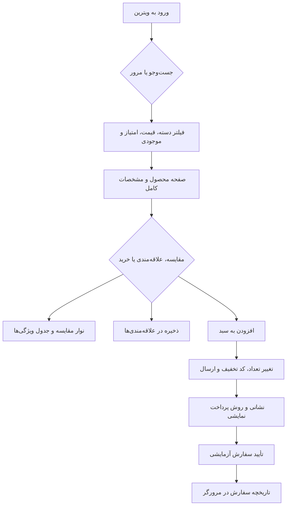

# نوا مارکت — فروشگاه آنلاین فارسی

یک نمونه‌کار مستقل فرانت‌اند برای مارکت‌پلیس چندفروشنده‌ای؛ از الگوهای آشنای خرید آنلاین استفاده می‌کند، اما برند و رابط کاربری اختصاصی دارد و کپی دیجی‌کالا نیست. رابط فارسی و راست‌چین است، واحد قیمت تومان است و کالاها، فروشندگان و نظرها دادهٔ نمایشی هستند.


## صفحه‌ها و قابلیت‌ها

- صفحهٔ اصلی با هویت بصری مستقل، دسته‌بندی‌ها، پیشنهادهای منتخب و ویترین محصولات
- صفحهٔ مستقل محصولات با جست‌وجو، فیلتر قیمت/امتیاز/موجودی/فروشنده و مرتب‌سازی
- صفحهٔ پیشنهادها، صفحهٔ محصول با معرفی، مشخصات فنی، دیدگاه‌ها، پرسش‌وپاسخ و محصولات مرتبط
- صفحهٔ اختصاصی هر فروشنده و صفحهٔ سفارش‌های من
- مقایسهٔ کنارهمی تا ۴ کالا با نوار مقایسهٔ شناور و واضح
- علاقه‌مندی‌ها، سبد خرید با کنترل تعداد، حذف کالا، هزینهٔ ارسال و کد آزمایشی `NAVA10`
- checkout دو مرحله‌ای، انتخاب شهر و نشانی، روش پرداخت نمایشی و تاریخچهٔ سفارش محلی
- ذخیرهٔ سبد، علاقه‌مندی‌ها، مقایسه، پرسش‌ها و سفارش‌ها در `localStorage`
- تصاویر محلی و نسخهٔ متغیر فونت فارسی Vazirmatn با فایل مجوز همراه پروژه

> این نسخه پرداخت، ثبت سفارش واقعی، ارسال کالا، احراز هویت یا دسترسی چندکاربره ندارد. سفارش‌گذاری و نظرها/پرسش‌ها برای نمایش جریان فرانت‌اند هستند.

## جریان اصلی خرید



## اجرا و بررسی

نیازمندی: Node.js 20+ و npm.

```bash
npm install
npm run dev
```

```bash
npm test
npm run typecheck
npm run build
npm audit
```

ساختار کد بر پایهٔ React و TypeScript است؛ هر صفحه و کامپوننت در پوشهٔ مستقل خودش قرار دارد و قراردادهای type در `src/types` نگهداری می‌شوند. alias داخلی `@/` در Vite و TypeScript تنظیم شده است.
